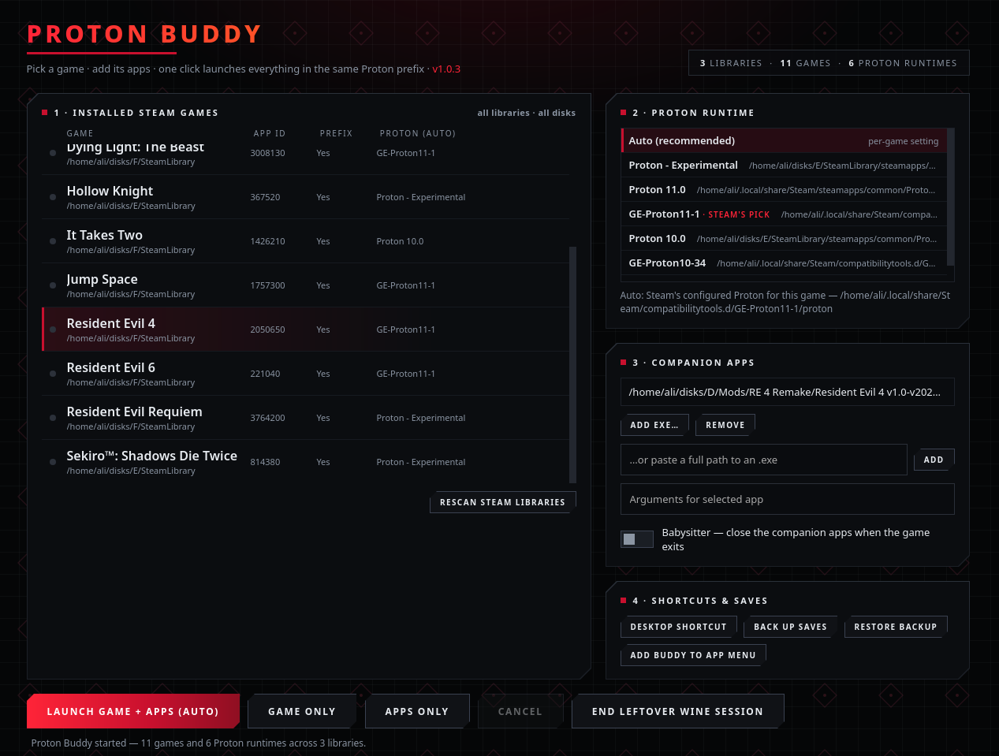

# Proton Buddy

Launch a Steam game on Linux together with its companion Windows apps
(Cheat Engine, trainers, mod tools) inside the **same Proton prefix** —
the trick SteamTinkerLaunch does, without the config maze.



Current release: **v1.0.3** — see [Releases](../../releases) for the ready-to-run AppImage.

## Download

Grab `Proton_Buddy-1.0.3-x86_64.AppImage` from the Releases page, `chmod +x` it, and run it — no install, no dependencies (it bundles its own Python). Or just run the script directly with any Python 3.

## How it works

Order matters, and Buddy enforces it: the **game starts first** via Steam
into a clean prefix, then the apps join the live session using the Proton
build's own `wine` binary. An app that grabs the prefix first makes Steam
refuse to start the game, and `proton run` into a live session can kill
the game — Buddy avoids both failure modes and blocks unsafe launches
with a clear explanation instead of a silent failure.

## Features

- Discovers all Steam libraries on all disks (native, Flatpak, and Snap
  Steam installs), all games, and all Proton builds (incl. GE-Proton)
- Per-game companion apps with custom arguments
- Per-game Proton override, or Auto (Steam's own per-game choice)
- AUTO launch: game first, apps second, into the same prefix
- Babysitter: companion apps close automatically when the game exits
- One-click save backup & restore (snapshots before restoring)
- Per-game desktop shortcuts for headless AUTO launches
- Native window (WebKitGTK) with browser fallback — no browser tab needed

## Requirements

- Linux + Steam (native, Flatpak, or Snap)
- Python 3 (stdlib only)
- For the native window: WebKitGTK Python bindings
  (Fedora: `sudo dnf install -y python3-gobject webkitgtk6.0` ·
  Debian/Ubuntu: `python3-gi gir1.2-webkit2-4.1`)
  Without them it falls back to a Chromium app window or browser tab.

## Usage

```
python3 proton_buddy.py            # open the app
python3 proton_buddy.py --list     # list discovered games/Protons
python3 proton_buddy.py --launch <appid>   # headless AUTO launch
```

Config lives in `~/.config/proton-buddy/` (per user, per machine —
nothing is tied to any specific PC).

## License

MIT — see [LICENSE](LICENSE).
